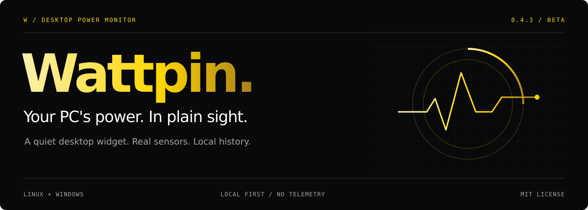
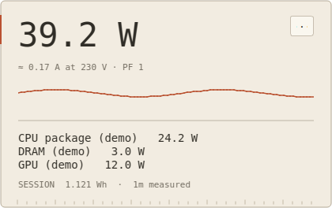
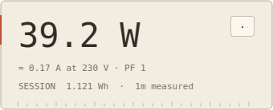
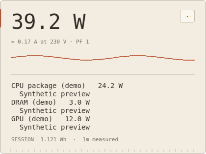
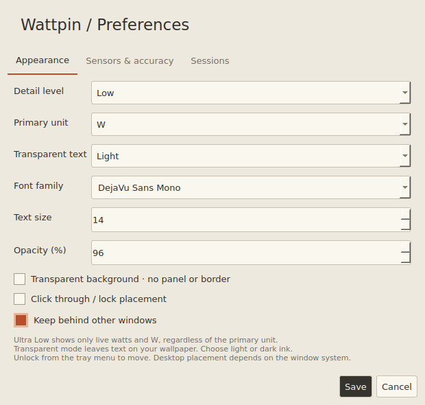
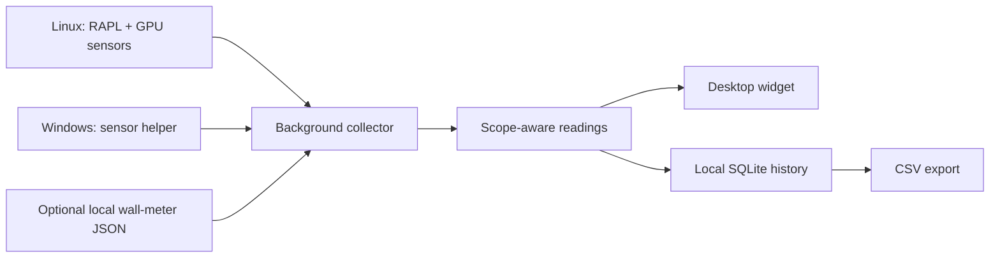

<p align="center">
  
</p>

<p align="center">
  <a href="https://github.com/Dtubxthjn/Wattpin/releases/tag/v0.4.4-beta">Download beta</a> ·
  <a href="#get-started">Get started</a> ·
  <a href="#a-widget-that-knows-when-to-get-out-of-the-way">Preview</a> ·
  <a href="docs/INSTALL.md">Installation guide</a> ·
  <a href="docs/TECHNICAL_GUIDE.md">How it works</a> ·
  <a href="CONTRIBUTING.md">Contribute</a>
</p>

<p align="center">
  <a href="https://github.com/Dtubxthjn/Wattpin/actions/workflows/checks.yml"></a>
  <a href="LICENSE"></a>
  
</p>

**Wattpin keeps power consumption visible without turning your desktop into a dashboard.**
Pin a tiny watt readout to your wallpaper, or expand it to reveal a live graph, component
readings, and session energy. Collection continues in the background, whichever view you choose.

No account. No cloud service. No telemetry. Your history stays on your computer.

> **Know what the number means.** Component sensors provide a partial PC total.
> Whole-PC wall power requires a suitable external meter. Wattpin shows unavailable
> readings honestly and labels estimates explicitly.

---

## A widget that knows when to get out of the way

<p align="center">
  
</p>

<p align="center"><sub>Application UI rendered with synthetic demo data. No personal power readings or device identifiers.</sub></p>

| Quiet on the desktop | Useful under the surface |
| :--- | :--- |
| **Four detail levels** — from a floating number to a sensor breakdown | **Session energy** — local SQLite history and CSV exports |
| **Transparent mode** — light or dark text, adjustable font and opacity | **Sensor-aware totals** — overlapping domains excluded conservatively |
| **Drag, place, lock** — click through after locking where supported | **Independent collection** — one-second samples across all display modes |
| **Start at login** — optional desktop integration | **External meter input** — a local JSON bridge for whole-PC readings |

### Four views. One collector.

| Ultra Low | Low | Medium | High |
| :--- | :--- | :--- | :--- |
| Live watts only | Draw, derived current, session energy | Graph and component readings | Sources and nested sensor domains |

<table>
  <tr>
    <td align="center" width="50%"><strong>Low / stay focused</strong><br /><br /></td>
    <td align="center" width="50%"><strong>High / inspect the details</strong><br /><br /></td>
  </tr>
</table>

<details>
<summary><strong>Appearance, sensors, and session preferences</strong></summary>
<br />
<p align="center"></p>
Right-click the unlocked widget or use the tray menu to open Preferences. If the app is
already running, launching it again brings up its preferences.
</details>

---

## Get started

**Version 0.4.4 is beta.** Linux X11 is the best-tested desktop target.
Windows support is included; native Windows hardware validation remains pending.

### Run from source

Use **Python 3.10+** and a graphical desktop. On Linux:

```bash
git clone https://github.com/Dtubxthjn/Wattpin.git
cd Wattpin
python3 -m venv .venv
.venv/bin/python -m pip install -e .
bash run.sh
```

The source checkout includes an Ubuntu/Mint x86-64 cursor compatibility library.
Other distributions may need their Qt/XCB runtime packages. X11 is recommended for
predictable placement and click through; Wayland behavior depends on the compositor.

For Windows source setup, use a virtual environment, install the project, and run `wattpin`.
The packaged Windows build also includes the separate hardware sensor helper.
See the [Windows hardware access and build guide](docs/INSTALL.md#windows-hardware-access).

### Installers and builds

[**Get Wattpin 0.4.4 Beta →**](https://github.com/Dtubxthjn/Wattpin/releases/tag/v0.4.4-beta)

Choose the Linux `.run` installer or Windows x64 setup wizard from the release assets.
Source archives, a Python wheel, and `SHA256SUMS` are included. Installers are unsigned.
Linux builds target Ubuntu 24.04 / glibc 2.39 or newer; Windows targets Windows 10 1809+
or Windows 11 x64. Physical Windows sensor validation remains pending.

The release workflow builds on fresh GitHub runners, tests both platforms, checks
publication archives, and publishes only after both build jobs pass.

[Full installation and removal guide →](docs/INSTALL.md)

---

## Real sensors. Clear boundaries.



- **Linux CPU energy:** RAPL energy-counter changes divided by actual elapsed time.
- **GPU power:** supported NVIDIA, AMD, or Nouveau readings, depending on platform and hardware.
- **Whole-PC power:** a fresh external-meter reading supersedes component totals.
- **No invented watts:** no CPU-load/TDP guesses or fixed disk, fan, and motherboard allowances.
- **Current is derived:** `A = W / (V × power factor)`. It is not a measured rail current.
- **Gaps stay gaps:** suspend, missing sensors, or coverage changes are not silently interpolated.

Optional wall-power estimates use user-entered allowances and PSU efficiency. They are
labeled estimates and do not change recorded sensor energy.

[Measurement details, permissions, and persistence →](docs/TECHNICAL_GUIDE.md#measurement-and-accuracy)

## Built to stay local

Wattpin uses Python and Qt (PySide6), with SQLite session storage. The Windows hardware
helper uses .NET and LibreHardwareMonitor. The widget runs as your user; optional Windows
hardware access elevates only its read-only sensor helper with your permission.

History and settings remain in the legacy `powerglass` data location for upgrade
compatibility. The default database commit interval is five seconds; abrupt termination
can lose uncommitted readings. Retained detailed readings are pruned, while session totals
remain. [Storage behavior →](docs/TECHNICAL_GUIDE.md#storage-and-verification)

Previously **Powerglass**. The Python package and storage identity keep that name so
existing preferences and history continue to work.

---

## Develop and contribute

```bash
python -m pip install -e '.[dev]'
QT_QPA_PLATFORM=offscreen python -m pytest -q
python -m build
```

The existing suite covers energy integration, rollover, domain selection, storage,
UI modes, IPC, and sensor failure behavior. CI runs the Linux suite on Python 3.10,
3.12, and 3.13; the Windows installer workflow includes regression and installation checks.

Bug reports, desktop compatibility notes, and carefully scoped sensor contributions are welcome.

| Project resources | |
| :--- | :--- |
| [Contributing](CONTRIBUTING.md) | Development and validation expectations |
| [Technical guide](docs/TECHNICAL_GUIDE.md) | Measurement, desktop behavior, storage, and source use |
| [Performance notes](docs/PERFORMANCE.md) | Local benchmark methodology and its limits |
| [Release audit](docs/RELEASE_AUDIT.md) | Verification record and beta limitations |
| [Changelog](CHANGELOG.md) | Release history |
| [Security](SECURITY.md) · [Third-party notices](THIRD_PARTY_NOTICES.md) | Privacy, reporting, and dependencies |
| [Publication privacy review](docs/PRIVACY_AUDIT.md) | Source checks, demo data, and public-history limits |

<p align="center"><sub>MIT licensed. A small instrument for a more understandable desktop.</sub></p>
